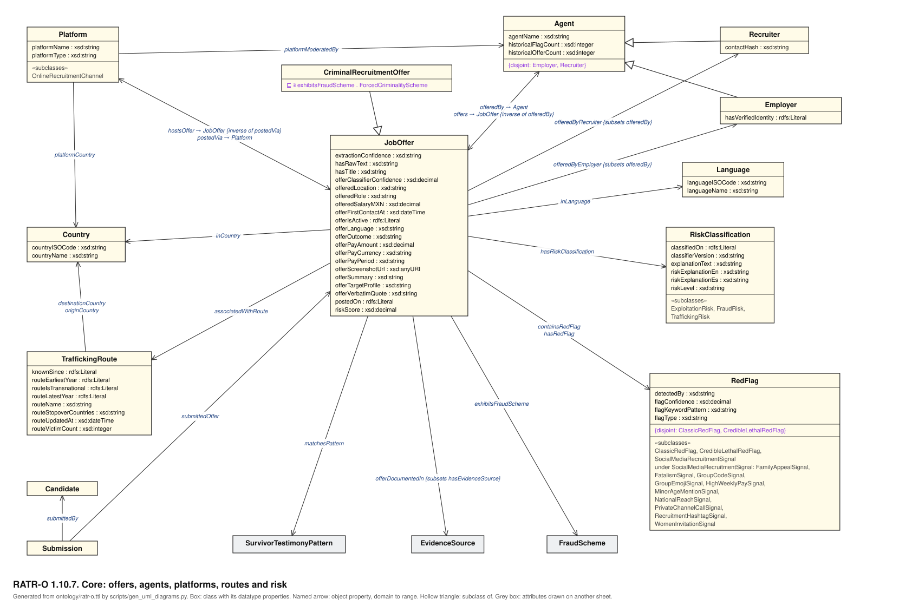
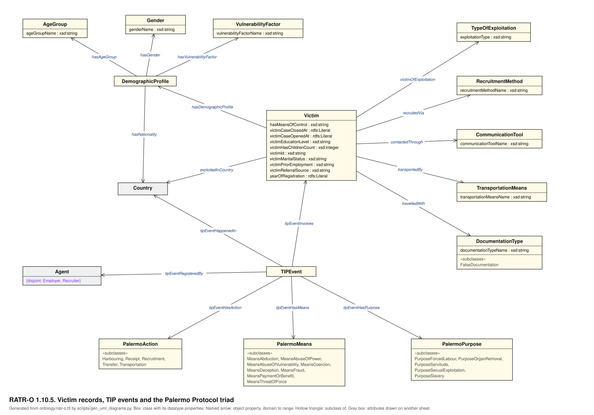
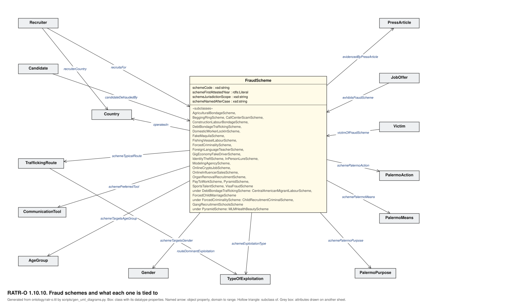
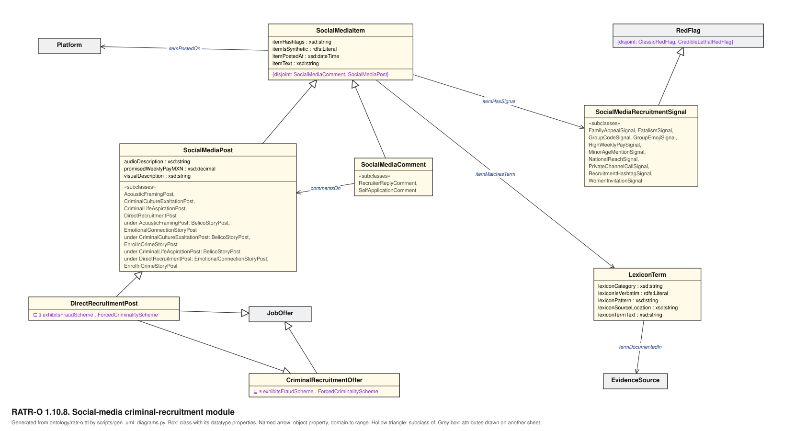
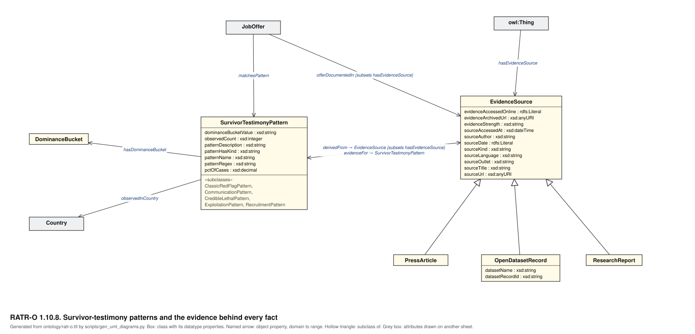
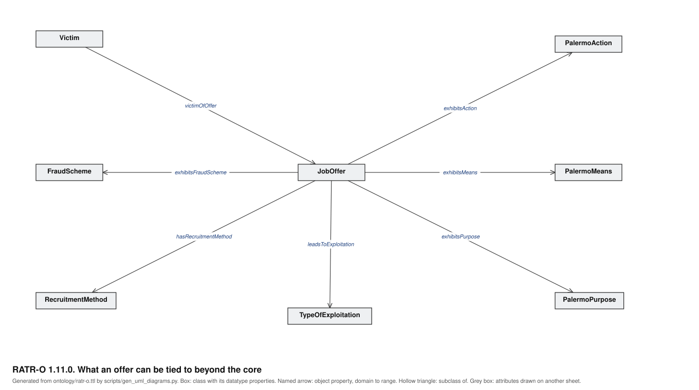

# RATR-O: UML-style class diagrams

Six sheets, generated from `ontology/ratr-o.ttl` by `scripts/gen_uml_diagrams.py`. Nothing in them is
drawn by hand: the script reads the classes, the datatype properties with their domain and range, the
object properties with their domain and range, the subclass axioms, the disjointness axioms and the
existential restrictions from the Turtle file, and a sheet only says which classes go on it and where.
The script stops with an error if a class or an object property of the ontology ends up on no sheet.
For v1.10.5 the six sheets cover all 114 classes and all 69 object properties.

## How to read them

| On the sheet | In the ontology |
| --- | --- |
| Box | `owl:Class`. The lines under the name are the datatype properties whose domain is that class, each with its range. |
| Arrow with a name | Object property, drawn from its domain to its range. |
| Arrowhead at both ends | Properties run both ways between the two classes; each name says which class it points to. |
| Hollow triangle | `rdfs:subClassOf`, pointing at the superclass. |
| `{subsets p}` | `rdfs:subPropertyOf p`. |
| `{inverse of p}` | `owl:inverseOf p`. |
| `{disjoint: A, B}` | `owl:disjointWith` between two subclasses of that class. |
| `⊑ ∃ p . C` | The class is a subclass of an existential restriction on `p` with filler `C`. |
| «subclasses» | Subclasses listed in the box instead of drawn, to keep the sheet legible. A class with several superclasses is listed under each. |
| Grey box | The class is drawn in full on another sheet; here it only anchors associations. |

UML is used here as a drawing convention. An OWL domain or range is an axiom from which membership is
inferred, not a constraint on what may be asserted, and nothing in these sheets says anything about
cardinality.

## 1. Core: offers, agents, platforms, routes and risk

The entities Objective 1 names: job offers, employers, recruiters, candidates, red flags, routes,
platforms and risk classifications.



## 2. Victim records, TIP events and the Palermo Protocol triad



## 3. Fraud schemes and what each one is tied to



## 4. Social-media criminal-recruitment module



## 5. Survivor-testimony patterns and the evidence behind every fact

`:hasEvidenceSource` has a range and deliberately no domain, so it is drawn from `owl:Thing`.



## 6. What an offer can be tied to beyond the core



## Regenerating

```bash
python scripts/gen_uml_diagrams.py
```
